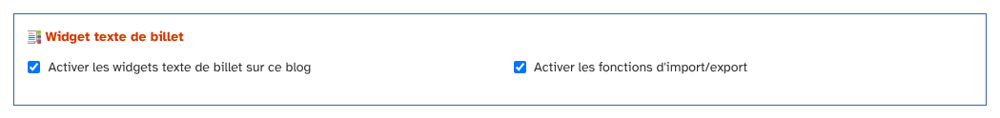
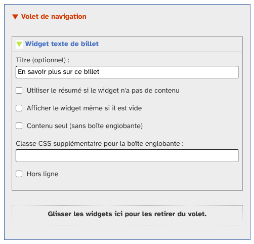
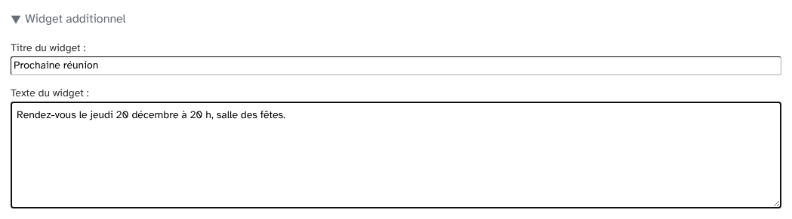
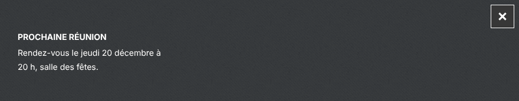
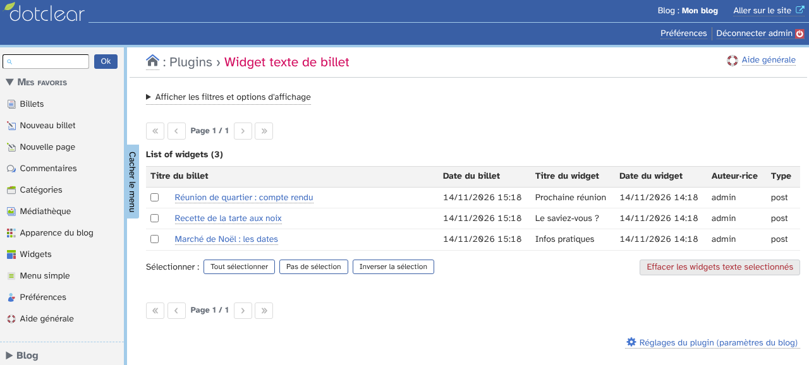
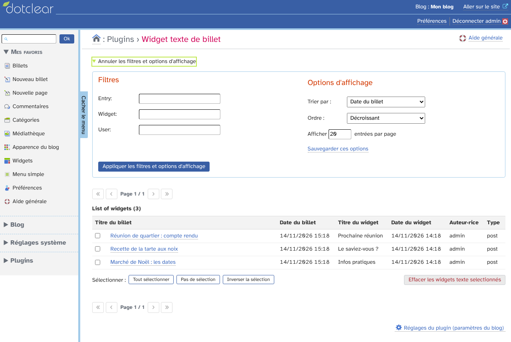
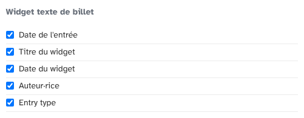
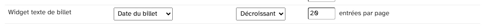

# postWidgetText : guide d'utilisation

_postWidgetText_ (« Widget texte de billet ») permet d'attacher à un billet un petit texte, affiché dans un widget de la barre latérale quand le visiteur lit ce billet.

## Sommaire

1. [Activer le plugin](#activer-le-plugin)
2. [Ajouter le widget au thème](#ajouter-le-widget-au-thème)
3. [Écrire le texte d'un billet](#écrire-le-texte-dun-billet)
4. [Le widget sur le blog](#le-widget-sur-le-blog)
5. [La liste des widgets](#la-liste-des-widgets)
6. [Préférences](#préférences)

## Activer le plugin

Le plugin se règle dans **Blog › Paramètres du blog**. Dépliez **Paramètres des plugins pour ce blog** : la section **Widget texte de billet** propose deux cases.

- **Activer les widgets texte de billet sur ce blog** : sans cette case, la section n'apparaît pas sur les pages d'édition et le menu du plugin est caché.
- **Activer les fonctions d'import/export** : les widgets sont inclus dans les exports et imports du blog.

## Ajouter le widget au thème

Dans **Apparence du blog › Widgets**, ajoutez le widget **Widget texte de billet** à un volet.

- **Titre** : titre affiché quand le widget du billet n'a pas de titre propre.
- **Utiliser le résumé si le widget n'a pas de contenu** : si le texte du widget du billet est vide, le résumé (extrait) du billet est affiché à la place.
- Les réglages habituels : contenu seul (sans boîte), classe CSS, hors ligne.

## Écrire le texte d'un billet

Sur la page d'édition d'un billet, la section **Widget additionnel** contient le **Titre du widget** et le **Texte du widget**. Cliquez sur le titre de la section pour la déplier ou la replier. Enregistrez le billet comme d'habitude.

Pour supprimer le widget d'un billet, videz le titre et le texte puis enregistrez.

## Le widget sur le blog

Sur la page du billet, le widget affiche le titre et le texte saisis.

Sur un billet qui n'a pas de widget, rien n'est affiché.

## La liste des widgets

Le menu **Plugins › Widget texte de billet** liste tous les widgets : billet, date du billet, titre du widget, date du widget, auteur et type.

Cliquez sur un billet pour modifier son widget. Cochez des widgets puis **Effacer les widgets texte selectionnés** pour les supprimer sans supprimer les billets.

Le bouton **Afficher les filtres et options d'affichage** permet de chercher par billet, widget ou utilisateur, de trier la liste et de choisir le nombre de lignes par page.

## Préférences

Dans **Préférences › Mes options**, vous pouvez choisir les colonnes de la liste, leur ordre, le tri par défaut et le nombre de lignes par page.

